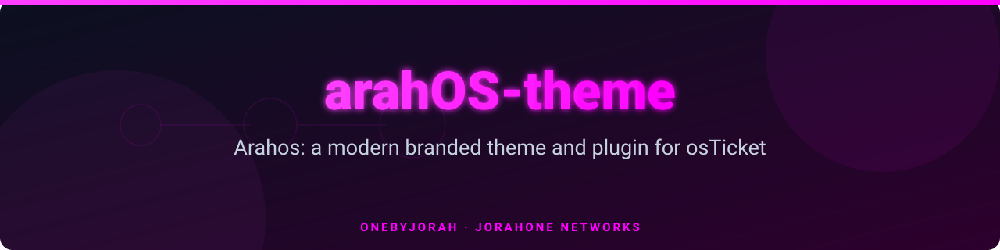
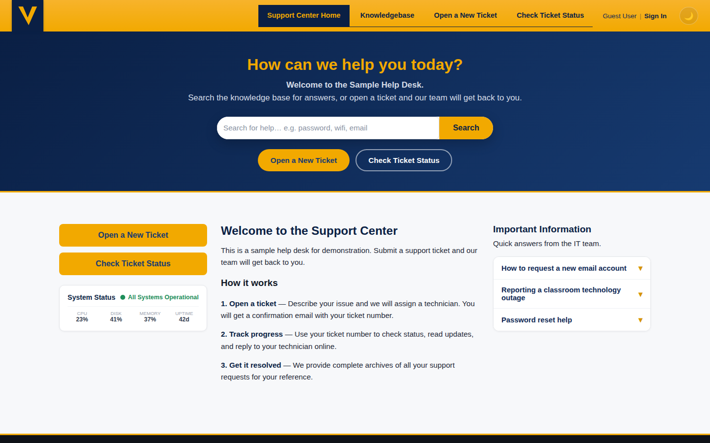
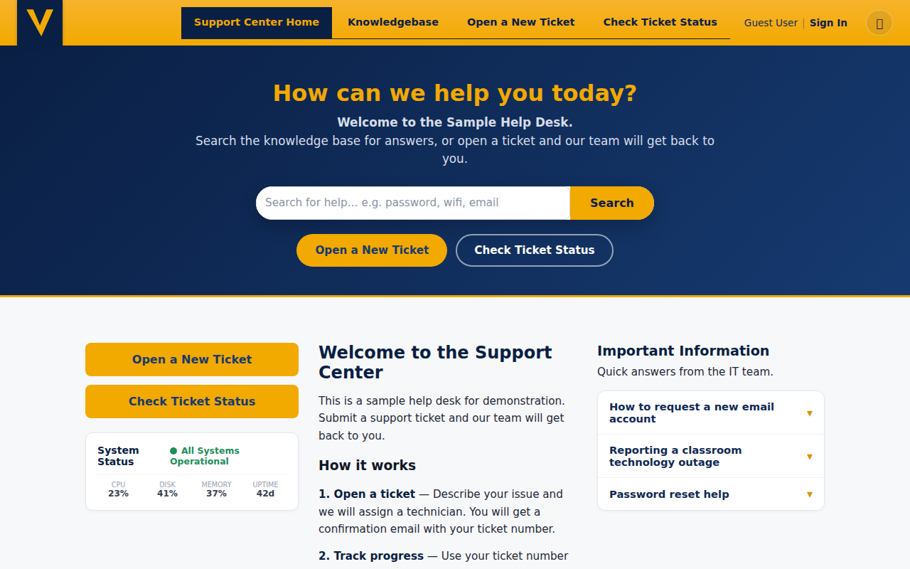
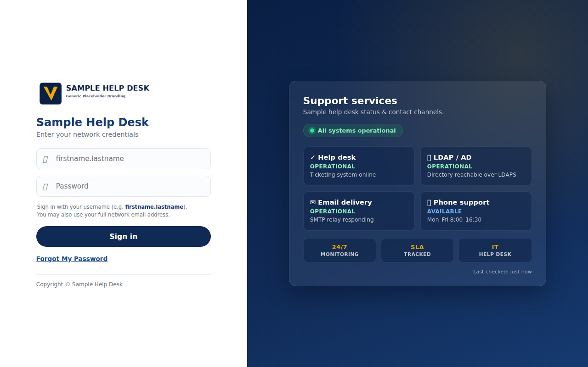
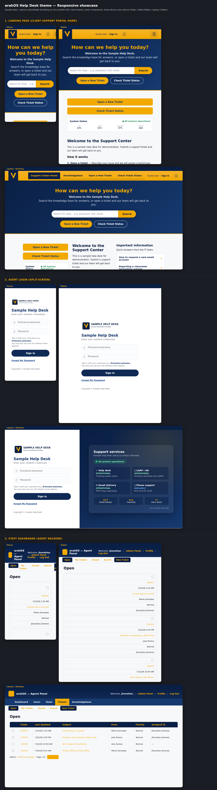
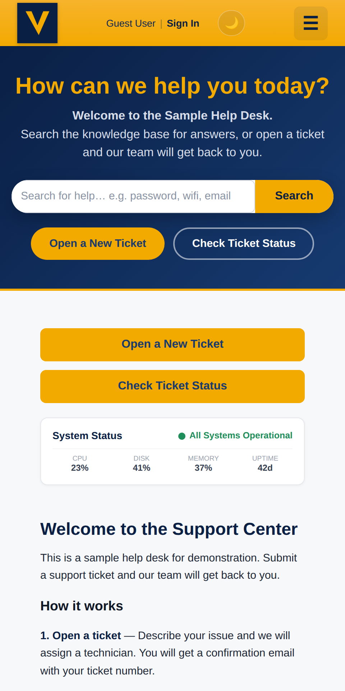

<div align="center">



# arahOS-theme

**A modern navy-and-gold theme and plugin for osTicket 1.18.x, branded for the arahOS organization.**

<a href="https://github.com/OneByJorah/arahOS-theme/stargazers"></a>
<a href="https://github.com/OneByJorah/arahOS-theme/commits"></a>


</div>



## What This Is

arahOS-theme applies the arahOS navy (`#0a1f44`) and gold (`#f2a900`) design language to a stock osTicket 1.18.x installation — client support portal and staff (agent) control panel included. It is shipped as an osTicket plugin plus the theme CSS/JS and template overrides it injects.

The theme adds a full-width backend, a split-screen agent login, a single-login redirect for client users, an enabled knowledge base with seed content, a working light/dark toggle, and a PWA front end — all from a single design-tokens stylesheet. Every showcase page uses generic "arahOS Help Desk" branding so screenshots never expose a live logo.

## Quick Start

```bash
git clone https://github.com/OneByJorah/arahOS-theme.git && cd arahOS-theme
sudo ./install.sh /path/to/osticket/upload
```

Then enable **arahOS Help Desk Theme** in **Admin Panel → Manage → Plugins**, and optionally load the KB seed: `mysql -u <user> -p <db> < db/kb-seed.sql`.

## Features

- **Navy + gold brand palette** — `#0a1f44` / `#f2a900`, driven entirely by `css/arahOS/arahOS-tokens.css`.
- **Full-width backend** — agent and admin panels use the whole screen.
- **Split-screen agent login** — credentials form plus a live "Support services" status panel.
- **Single login** — client `login.php` redirects to the unified agent login.
- **Knowledge base / FAQ** — enabled with seeded categories, Q&A, and Front Page instructions (`db/kb-seed.sql`).
- **Light/dark mode** — a working, persisted toggle.
- **Fully responsive** — breakpoints at 380 / 480 / 600 / 768 / 900 / 1100 px.
- **PWA-ready** — install banner, service worker, offline page, manifest, and square icons.

## Architecture

```
arahOS-theme/
├── plugin/                  # osTicket plugin (manifest + class, client/staff CSS)
├── css/arahOS/              # tokens, agent-login, client-portal, staff-panel stylesheets
├── js/arahOS/               # landing, PWA install, client-portal, staff-panel scripts
├── include/
│   ├── client/              # header/footer/login/accesslink overrides
│   └── staff/               # header/footer/login template overrides
├── images/arahOS/           # logos, seal, PWA icons
├── db/kb-seed.sql           # knowledge-base seed content
├── showcase/                # landing, agent-login, staff-dashboard, responsive demos
├── index.php                # branded landing page
├── manifest.webmanifest, sw.js, offline.html, .htaccess
└── install.sh               # installer
```

osTicket bootstraps plugins before the global `$ost` header API is available, so the theme CSS is emitted by the overridden header templates (which run after `$ost`/`$cfg` are live). The plugin still exists so the theme is discoverable and enable-able in the admin panel and its install path is known.

## Manual install

1. Copy `plugin/` → `<osticket>/include/plugins/arahOS-theme/`
2. Copy `css/arahOS/arahOS-*.css` → `<osticket>/css/arahOS/`
3. Copy `js/arahOS/arahOS-*.js` → `<osticket>/js/arahOS/`
4. Copy the `include/staff/` and `include/client/` template overrides into place
5. Copy `index.php` → `<osticket>/index.php`
6. Copy `images/arahOS/`, `manifest.webmanifest`, `sw.js`, `offline.html`, and `.htaccess` to the web root
7. Set ownership (`chown -R www-data:www-data <osticket>`)
8. Enable **Admin Panel → Manage → Plugins → arahOS Theme**

## Design tokens

| Token | Value | Use |
|---|---|---|
| `--arahOS-navy-900` | `#0a1f44` | Header / nav |
| `--arahOS-gold-500` | `#f2a900` | Accent |

Edit `css/arahOS/arahOS-tokens.css` to rebrand — every stylesheet reads from these variables.

## Showcase

Browse `/showcase/responsive.html` after installing: a 3×3 grid of (Phone / Tablet / Laptop) × (Landing / Agent login / Staff dashboard). Static demos live in `showcase/landing.html`, `showcase/agent-login.html`, and `showcase/staff-dashboard.html`.

## Compatibility

- osTicket **1.18.x** (tested on 1.18.4)
- PHP 8.x, MySQL/MariaDB
- HTTPS required for the PWA install prompt and service worker to fully activate

## Tech Stack

CSS3, vanilla JavaScript, PHP (osTicket plugin + template overrides), Bash (installer), MySQL/MariaDB.

## Screenshots

| View | |
|---|---|
|  |  |
|  |  |
|  |  |

## Security

See [SECURITY.md](SECURITY.md). Report vulnerabilities privately to **security@jorahone.com**.

## Contributing

See [CONTRIBUTING.md](CONTRIBUTING.md). All contributions follow the [Code of Conduct](CODE_OF_CONDUCT.md). [Open an issue](https://github.com/OneByJorah/arahOS-theme/issues) for bugs or ideas.

## License

MIT — see [LICENSE](LICENSE). © Jhonattan L. Jimenez (OneByJorah / JorahOne Networks).

## Connect

- [jorahone.com](https://jorahone.com)
- [GitHub Org](https://github.com/OneByJorah)
- [info@jorahone.com](mailto:info@jorahone.com)
