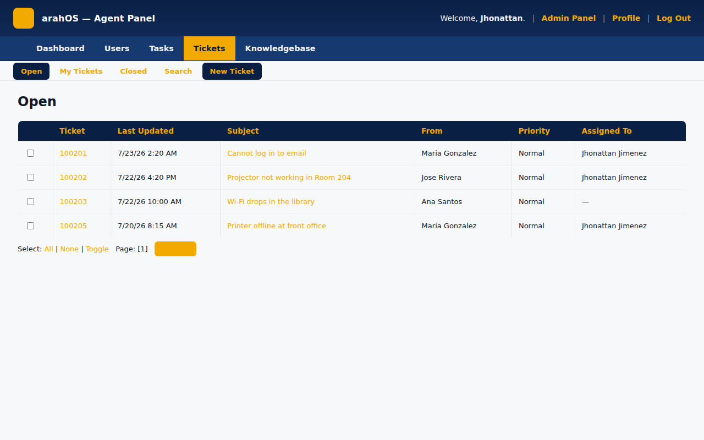

# arahOS-theme

> Navy-and-gold theme and plugin for osTicket 1.18.x — restyles the client portal and staff panel, adds a knowledge base, light/dark toggle, and PWA support, for help desks that want a branded ticket system without rebuilding osTicket.

[](https://github.com/OneByJorah/arahOS-theme)
[](https://github.com/OneByJorah/arahOS-theme)
[](https://github.com/OneByJorah/arahOS-theme/stargazers)
[](https://github.com/OneByJorah/arahOS-theme/commits)



## What This Is

Stock osTicket looks like stock osTicket, and rebranding it means hunting through header templates and scattered CSS. arahOS-theme applies the arahOS navy (`#0a1f44`) and gold (`#f2a900`) design language to both sides of an osTicket 1.18.x install — client portal and staff control panel — shipped as an installable plugin plus the template overrides and assets it loads. It is for teams running osTicket who want a coherent branded help desk, an enabled knowledge base, and PWA installability out of the box.

## Quick Start

```bash
git clone https://github.com/OneByJorah/arahOS-theme.git && cd arahOS-theme
sudo ./install.sh /path/to/osticket/upload
```

Then enable **arahOS Help Desk Theme** under **Admin Panel → Manage → Plugins**, and optionally seed the knowledge base: `mysql -u <user> -p <db> < db/kb-seed.sql`.

## Features

- Full rebranding of both client portal and staff/agent panel from one design-tokens stylesheet
- Full-width backend layout so agent and admin screens use the whole page
- Split-screen agent login with a live "Support services" status panel
- Single-login redirect: client `login.php` forwards to the unified agent login
- Knowledge base with seeded categories, Q&A, and front-page instructions (`db/kb-seed.sql`)
- Persisted light/dark mode toggle
- Responsive breakpoints at 380 / 480 / 600 / 768 / 900 / 1100 px
- PWA support: install banner, service worker, offline page, manifest, and square icons

## Architecture

osTicket bootstraps plugins before the global `$ost` header API exists, so the theme CSS is emitted by overridden header templates (which run after `$ost`/`$cfg` are live); the plugin itself makes the theme discoverable and enable-able from the admin panel. Static showcase pages under `showcase/` render the landing, login, and dashboard views without an osTicket install.

## Stack

CSS3, vanilla JavaScript, PHP (osTicket plugin + template overrides), Bash installer, MySQL/MariaDB. Tested against osTicket 1.18.x on PHP 8.x.

## Contributing

Contributions are welcome — read [CONTRIBUTING.md](CONTRIBUTING.md), then [open an issue](https://github.com/OneByJorah/arahOS-theme/issues). Browse `showcase/responsive.html` after installing to check the theme across form factors.

## License

MIT — see LICENSE.
